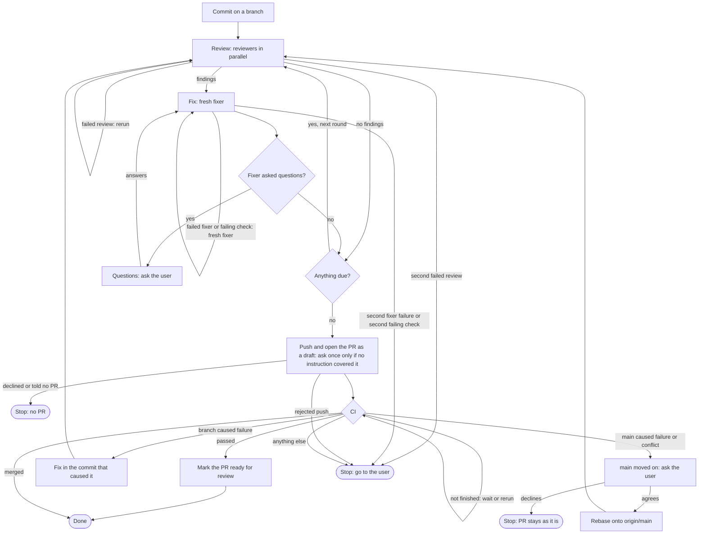
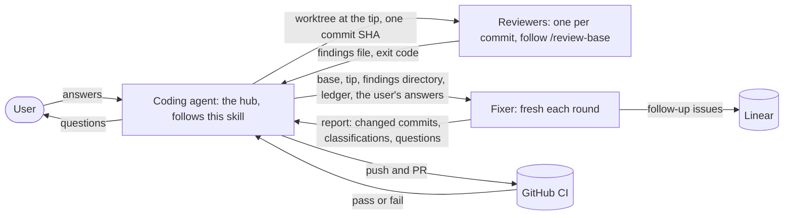

# Review loop

Skip this skill when `REVIEW_LOOP_ROLE` is set: another agent spawned you, so hand back to it, since the loop needs the user to answer questions. Skip it too when the user asked to leave the change uncommitted or unpushed.

Done means the PR's CI passed and it is marked ready for review. The root `AGENTS.md` rule to ask before git writes does not apply to this skill's commits, worktrees, rewrites, pushes, the PR and PR edits; **Push and open the PR** says when a push needs asking.

Work from the repo root of the main checkout or of a worktree `scripts/new-worktree.sh` created, since it refuses to create a worktree from any other. Arriving because the PR's CI failed, start at **CI**.

The sections after the two charts hold the rules.



The process chart shows where you are; the role chart shows who you are and what you owe whom.



## The loop

Commit your work on a branch of your own, creating one if you are on `main`; ask the user about uncommitted changes that aren't yours; `git fetch origin`. The base is `git merge-base origin/main HEAD`, before and after a push: every commit not merged to `main` is open to rewriting, even after someone has reviewed the PR. Before any review, go to the user, as for a rejected push, when `<base>..HEAD` holds a merge commit, which `/review-base` can't review. A round is:

1. **Review.** Every commit in `<base>..HEAD` due a review gets its own reviewer at the round's tip: `scripts/new-worktree.sh <name> --from <tip>` from this checkout, with a short name no worktree or branch uses, then in that worktree `mkdir .scratch` and `claude -p` per `agents/skills/subagents/SKILL.md` with the prompt `` /review-base base is `git show --stat <sha>` ``. Run a handful at a time in the background and wait for all of them. A review passed when `claude` exited 0 and its `.scratch/review/<sha>.json` names that base with a filled-in summary, which review-base writes last. Any other outcome is a failed review. Copy a passing file into `.scratch/review-loop/<branch>/round-<n>/`, and a failed run's `.scratch/<name>.err` and `.scratch/<name>.jsonl` there too, since removal deletes them; then `scripts/rm-worktree.sh <name>` whichever the outcome. Rerun a failed review in a fresh worktree; a failed review never counts as clean, and a second failure of the same review goes to the user with those logs.
2. **Fix.** Skip when every review's `findings` is empty. Fill in every `{{...}}` of `agents/skills/review-loop/fixer-prompt.md`, with `{{LEDGER}}` the one path `.scratch/review-loop/<branch>/ledger.md` every round, and run a fresh fixer with it per `agents/skills/subagents/SKILL.md`, never `--resume`. Leave the checkout alone while it runs, since it rewrites the branch. Its final message says which commits changed, which unchanged commits need another review, which checks it could not get to pass, which follow-ups it could not file, and its questions. A follow-up it could not file goes to the user with the reason, except a cut's, which you file yourself, recording its ID on the cut's ledger line, retrying at the start of each later round and before the push until it is filed. Tell the user nothing about cuts or other changes to a subject they made conditional or said "I don't care" about. If it exited nonzero or wrote no result, run `git rebase --abort` when a rebase is in progress, confirm the branch is checked out, and run a fresh fixer on the same round; a second failure in a row goes to the user with its `.err` and the end of its `.jsonl`. If it reported a failing check, brief another fixer on the same round with it as `{{FAILED_CHECKS}}`; a check the second can't get to pass goes to the user, and the round stays unfinished until it passes.
3. **Questions.** Relay its questions to the user in the **Open questions** format of the root `AGENTS.md`. They may answer, find someone who can, or say they don't know or don't care; each is an answer. Then brief another fixer on the same round with the answers, so it fixes what waited on them. The next round starts once every question has an answer.

Due a review: in a branch's first round every commit; afterwards every commit with no review yet or whose diff changed since its last review (`git patch-id --verbatim` on `git show --no-color <sha>` tells a changed diff from a rebased or reworded one), plus the commits the fixer named, and after a CI fix each commit above the fixed one that the fix affects. An unchanged commit counts as clean when its last review passed with no fix-now findings, so findings that became follow-ups or drops don't keep it under review. A re-review is a full review of the commit, not one narrowed to what changed. Repeat rounds, with no cap and without stopping between them to ask the user whether to go on or to report progress, until a round leaves nothing due, no question unanswered and no check failing: a round with a fix-now finding changes a commit, and every change gets at least one further full review. Re-entering the loop after a push continues its round numbers and keeps its earlier reviews.

## Push and open the PR

An instruction from the user that asked for a PR or a push, at any point in the task, approves every push, the PR and every PR edit this skill makes, apart from the question in **`main` moved on**. When no instruction covered either, list the commits for the user and ask once, before the first push; their approval covers the same, and if they decline, stop with the commits on the branch. Once approved, with a PR already open, first `gh pr ready --undo`, since the commits about to land have not passed CI. Then push: `git push -u origin HEAD` while the branch is not on origin, otherwise `git push --force-with-lease --force-if-includes origin HEAD`, on the task's own PR branch only, since the loop may have rewritten pushed commits. A rejected push goes to the user, since someone else may have pushed to the branch. On the first pass, `gh pr create --draft` with a description written from the commits. Before writing or editing a PR description that names a Linear issue, read `agents/skills/linear/SKILL.md`. A user who asked for no PR gets none: stop after an approved push, otherwise with the commits on the branch. Later pushes and PR edits go ahead without asking. On a later pass, `gh pr edit` the description only where the branch's changes since the last push made it wrong.

## CI

```bash
sleep 60; gh pr checks --watch --interval 60
```

One blocking wait, in the background with your harness's longest time limit; run it again if the limit stops it. The sleep lets `gh pr create`'s `pull_request` workflows register, since the watch exits 0 once the checks it can see have finished, and a check the push started can finish first.

Exit 0 covers only checks that ran to an end: gh counts a cancelled check as neither failed nor pending, and GitHub starts no `pull_request` workflow on a conflicted PR. On a PR with no checks the watch and every `gh pr checks` fail with `no checks reported`. So whatever the watch's exit, start with `gh pr view --json state,mergeable`, which needs no checks:

- `MERGED`: done. `CLOSED`: tell the user and stop. `CONFLICTING`: `gh pr ready --undo`, then **`main` moved on**. `UNKNOWN`: read it again in a minute.
- Open and `MERGEABLE` after `no checks reported`: run the wait again; a second time goes to the user.
- Open and `MERGEABLE` otherwise: `gh pr checks --json name,bucket,link --jq '.[] | select(.bucket | IN("fail", "cancel", "pending"))'` lists failed, cancelled and pending checks with the run id in each link. None listed: `gh pr ready`, and it is done. Any `fail` is a failure, below. Any `pending` means the watch stopped early: run the wait again. Otherwise `gh run rerun <run-id>` each cancelled run once and watch again; a check cancelled twice, or with no run to rerun, goes to the user.

On a failure, `gh pr ready --undo`; `gh run view <run-id> --log-failed > .scratch/ci-failure-<run-id>.log` keeps the log; read its tail. A failure the branch caused: fix it in the commit that caused it, per review-base's **Applying fixes**; run the `implement` skill's **Checks** over that commit and each one above it, for example `git rebase --exec '<checks>' <fixed-sha>^`; run **The loop**; push as **Push and open the PR** says. A failure from changes on `main`: **`main` moved on**. Anything else, a runner outage or a missing secret, goes to the user.

## `main` moved on

Tell the user what conflicts or fails and ask whether to update the branch. If they decline, stop; the PR stays as it is. If they agree:

1. `git fetch origin && git rebase origin/main`, resolving conflicts. Never merge `main` in, since `/review-base` reviews a commit against one parent.
2. Run **The loop**, so each commit the rebase changed, conflict resolutions included, is reviewed and `main`'s commits are not.
3. Push as **Push and open the PR** says, then **CI**.
