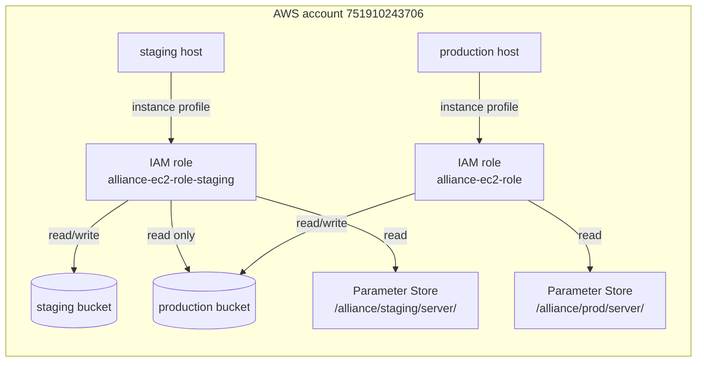
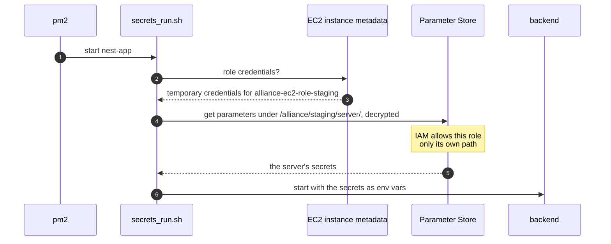

# Backend secrets

The staging and production backends read their secrets from AWS SSM Parameter Store when the process starts. Settings that aren't secret are committed in `common/src/deployed-config.ts`, and the RDS CA bundle in `server/src/config/rds-us-west-2-bundle.pem`.

## How a backend gets its secrets

`scripts/secrets_run.sh`, installed on each host as `~/secrets_run.sh`, reads every parameter under `/alliance/<env>/server/` with the host's instance role and runs its command with them as env vars, `<env>` picked by `NODE_ENV`. It refuses a parameter named like a variable already set, such as `NODE_ENV`, rather than override it. pm2 starts the app through it, and the deploy runs migrations and the streak recognition script through it. The deploy first runs the config check through the new release's copy and installs that copy only once the check passes.

| Host       | IAM role                    | Reads                       |
| ---------- | --------------------------- | --------------------------- |
| staging    | `alliance-ec2-role-staging` | `/alliance/staging/server/` |
| production | `alliance-ec2-role`         | `/alliance/prod/server/`    |

The parameters are SecureStrings under the AWS managed `aws/ssm` key. Each host's IAM role has one Parameter Store permission, `ssm:GetParametersByPath`, granted on its own environment's path and on everything under it (`arn:aws:ssm:us-west-2:751910243706:parameter/alliance/<env>/server` and `…/server/*`, in `terraform/secrets.tf`), so staging has no path to production's secrets, and nothing on the host stores a credential:



Each start, on staging; production is the same with its own role and path:



The parameters hold only what the server reads, under the server's own names (`server/src/config/env.ts`).

## Adding or rotating a secret

Signed in to AWS as an admin (IAM Identity Center), set the parameter for each environment, then restart the backend (`pm2 restart nest-app`) or deploy; a running process keeps the values it started with.

A new name also goes in the server's schema, `server/src/config/env.ts`. The `parameter-drift` workflow, run on PRs that change the schema and on every push to `main`, fails when `/alliance/<env>/server/` lacks a key the schema requires there or holds one that `inDeployedStore`, in the same file, leaves out of those paths. Nothing reruns it after a store edit, so dispatch it on `main` (Actions, Parameter drift, Run workflow) once you add or delete a parameter. Add a key in three steps, so neither the workflow nor a deploy fails in between:

1. Merge its field as optional, with `inDeployedStore` true.
2. Set the parameter in each environment.
3. Make it required, in `deployedSet` or `setFor`.

Remove a key the other way:

1. Make it optional, until `bun scripts/check-parameter-drift.ts --required`, which needs no login, no longer lists it for that path (which can mean editing `fields` or `conditionallyRequired` as well as `deployedSet` or `setFor`), and stop reading it, then deploy.
2. Delete the parameter.
3. Remove its field and `inDeployedStore` entry.

The startup check fails on a required key that's gone, and the workflow on one `inDeployedStore` no longer lists. Once the parameter is gone, a rollback to a release from before the first step fails at startup.

In the console: **Systems Manager → Parameter Store**, open the parameter and **Edit**, or **Create parameter** with name `/alliance/<staging|prod>/server/<NAME>`, tier Standard, type SecureString, KMS key `alias/aws/ssm`. Parameter Store keeps each parameter's last 100 versions.

From the CLI, keep the value out of shell history and argv by putting it in a file only you can read, with no trailing newline, and passing the file:

```bash
aws ssm put-parameter --region us-west-2 --type SecureString --overwrite \
  --name /alliance/<staging|prod>/server/<NAME> --value file://value.txt
rm value.txt
```

The deploy runs the new release's config check under the wrapper before it stops the running backend. A missing key or an unreachable Parameter Store fails the deploy and leaves the old backend running.

## Secret files kept for admins

`/alliance/shared/` holds secret files kept only for admins, such as the hosts' SSH key `EC2_SSH_KEY`; no role is granted it, and it is unrelated to `/alliance/ci/shared/`. The `parameter-drift` workflow reports a parameter there whose name isn't in `SHARED_KEYS` in `scripts/check-parameter-drift.ts`, but never requires one. To add one, merge its name into `SHARED_KEYS`, then create `/alliance/shared/<NAME>` with the console or CLI steps above. To remove one, delete the parameter first, then its `SHARED_KEYS` entry. Dispatch the workflow on `main` after each store edit.

## When the fetch fails

A running backend doesn't need Parameter Store. A deploy fails and leaves the old backend running. A restart or a host reboot leaves the backend down while pm2 retries, up to every 15 seconds, until the fetch succeeds. Meanwhile `pm2 logs nest-app` shows the errors from `secrets_run.sh` or the AWS CLI.

When Parameter Store itself is down, the deploy keeps no copy of the secrets outside it, so the backend comes back when the store does.

When only this host can't read, for example after its role or policy breaks, start the backend by hand. A teammate who can read Parameter Store prints the server's secrets as shell-quoted `NAME='value'` lines:

```bash
aws ssm get-parameters-by-path --region us-west-2 --path /alliance/<env>/server/ \
  --with-decryption --output json \
  | jq -r '.Parameters[] | "\(.Name | split("/") | last)=\(.Value | @sh)"'
```

On the host, which admins reach over SSH with the key at `/alliance/shared/EC2_SSH_KEY`, create a file only you can read with `install -m 600 /dev/null ~/server.env` and paste those lines into it in an editor, not with `export` or `echo`, which leave them in shell history. Keep the quoting: the file is sourced by the shell, so an unquoted `$`, space, quote or backtick silently changes the value. Then from `~/nest-backend/server`:

```bash
pm2 delete nest-app
set -a; . ~/server.env; set +a
NODE_ENV=<staging|production> pm2 start "bun src/main.ts" --name nest-app --interpreter none
rm ~/server.env
```

Don't `pm2 save` this process, and hold frontend deploys, which run `pm2 save` on the same host: a save writes this process with its secrets into `~/.pm2/dump.pm2` and brings it back on reboot. Once the host can read again, the next backend deploy replaces it with the wrapper-backed one; until then, a reboot leaves the backend down. If a save ran anyway, that deploy's own `pm2 save` moves the copy into `~/.pm2/dump.pm2.bak`; delete that file afterwards.
