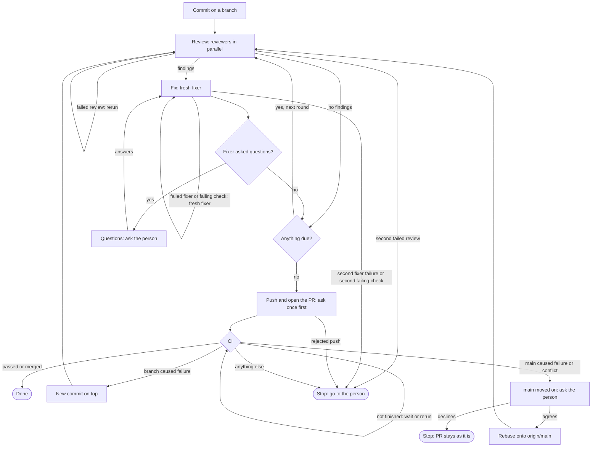

# Review loop

Skip this skill when `REVIEW_LOOP_ROLE` is set: another agent spawned you, so hand back to it, since the loop needs a person to answer questions and approve the push. Skip it too when the person asked to leave the change uncommitted or unpushed.

Done means the PR is open and its CI passed. The root `AGENTS.md` rule to ask before git writes does not apply to this skill's commits, worktrees and rewrites.

Work from the repo root of the main checkout or of a worktree `scripts/new-worktree.sh` created, since it refuses to create a worktree from any other. Arriving because the PR's CI failed, start at **CI**.

The chart shows which stage you are in; the sections below hold the rules.



## The loop

Commit your work on a branch of your own, creating one if you are on `main`; ask the person about uncommitted changes that aren't yours; `git fetch origin`. The base is the branch's upstream once it is pushed, else `origin/main`. A round is:

1. **Review.** Every commit in `<base>..HEAD` due a review gets its own reviewer at the round's tip: `scripts/new-worktree.sh <name> --from <tip>` from this checkout, with a short name no worktree or branch uses, then in that worktree `mkdir .scratch` and `claude -p` per `skills/subagents/SKILL.md` with the prompt `` /review-base base is `git show --stat <sha>` ``. Run a handful at a time in the background and wait for all of them. A review passed when `claude` exited 0 and its `.scratch/review/<sha>.json` names that base with a filled-in summary, which review-base writes last. Any other outcome is a failed review. Copy a passing file into `.scratch/review-loop/<branch>/round-<n>/`, and a failed run's `.scratch/<name>.err` and `.scratch/<name>.jsonl` there too, since removal deletes them; then `scripts/rm-worktree.sh <name>` whichever the outcome. Rerun a failed review in a fresh worktree; a failed review never counts as clean, and a second failure of the same review goes to the person with those logs.
2. **Fix.** Skip when every review's `findings` is empty. Fill in every `{{...}}` of `skills/review-loop/fixer-prompt.md`, with `{{LEDGER}}` the one path `.scratch/review-loop/<branch>/ledger.md` every round, and run a fresh fixer with it per `skills/subagents/SKILL.md`, never `--resume`. Leave the checkout alone while it runs, since it rewrites the branch. Its final message says which commits changed, which unchanged commits need another review, which checks it could not get to pass, which follow-ups it could not file, and its questions. A follow-up it could not file goes to the person with the reason. If it exited nonzero or wrote no result, run `git rebase --abort` when a rebase is in progress, confirm the branch is checked out, and run a fresh fixer on the same round; a second failure in a row goes to the person with its `.err` and the end of its `.jsonl`. If it reported a failing check, brief another fixer on the same round with it as `{{FAILED_CHECKS}}`; a check the second can't get to pass goes to the person, and the round stays unfinished until it passes.
3. **Questions.** Relay its questions to the person in the **Open questions** format of the root `AGENTS.md`. They may answer, find someone who can, or say they don't know or don't care; each is an answer. Then brief another fixer on the same round with the answers, so it fixes what waited on them. The next round starts once every question has an answer.

Due a review: in a branch's first round every commit; afterwards every commit with no review yet or whose diff changed since its last review (`git patch-id --verbatim` on `git show --no-color <sha>` tells a changed diff from a rebased or reworded one), plus the commits the fixer named. A re-review is a full review of the commit, not one narrowed to what changed. Repeat rounds, with no cap, until a round leaves nothing due, no question unanswered and no check failing: a round with a fix-now finding changes a commit, and every change gets at least one further full review. Re-entering the loop after a push continues its round numbers and keeps its earlier reviews.

## Push and open the PR

List the commits for the person and ask once, before the first push and PR; on their approval, `git push -u origin HEAD` and `gh pr create` with a description written from the commits. Later pushes and PR edits go ahead without asking. Never force, except in **`main` moved on**. A rejected push goes to the person, since someone else may have pushed to the branch. On a later pass, `gh pr edit` the description only where a new commit made it wrong.

## CI

```bash
sleep 60; gh pr checks --watch --interval 60
```

One blocking wait, in the background with your harness's longest time limit; run it again if the limit stops it. The sleep lets `gh pr create`'s `pull_request` workflows register, since the watch exits 0 once the checks it can see have finished, and a check the push started can finish first.

Exit 0 covers only checks that ran to an end: gh counts a cancelled check as neither failed nor pending, and GitHub starts no `pull_request` workflow on a conflicted PR. On a PR with no checks the watch and every `gh pr checks` fail with `no checks reported`. So whatever the watch's exit, start with `gh pr view --json state,mergeable`, which needs no checks:

- `MERGED`: done. `CLOSED`: tell the person and stop. `CONFLICTING`: **`main` moved on**. `UNKNOWN`: read it again in a minute.
- Open and `MERGEABLE` after `no checks reported`: run the wait again; a second time goes to the person.
- Open and `MERGEABLE` otherwise: `gh pr checks --json name,bucket,link --jq '.[] | select(.bucket | IN("fail", "cancel", "pending"))'` lists failed, cancelled and pending checks with the run id in each link. None listed is done. Any `fail` is a failure, below. Any `pending` means the watch stopped early: run the wait again. Otherwise `gh run rerun <run-id>` each cancelled run once and watch again; a check cancelled twice, or with no run to rerun, goes to the person.

On a failure, `gh run view <run-id> --log-failed > .scratch/ci-failure-<run-id>.log` keeps the log; read its tail. A failure the branch caused: fix it in a new commit on top, since the pushed commits are now the base and stay as they are, run **The loop** on it, push. A failure from changes on `main`: **`main` moved on**. Anything else, a runner outage or a missing secret, goes to the person.

## `main` moved on

Tell the person what conflicts or fails and ask whether to update the branch. If they decline, stop; the PR stays as it is. If they agree:

1. `git fetch origin && git rebase origin/main`, resolving conflicts. Never merge `main` in, since `/review-base` reviews a commit against one parent.
2. Run **The loop** with base `origin/main`, so each commit the rebase changed, conflict resolutions included, is reviewed and `main`'s commits are not.
3. `git push --force-with-lease --force-if-includes origin HEAD`, on the task's own PR branch only, then **CI**.
